# 🎬 Cinema Ticketing & Management System

A premium, full-stack movie booking platform featuring real-time seat selection, secure payments, and a comprehensive admin dashboard.

---

## 🔗 Live Demo

**Check out the live application here:** [Live Demo Link](https://chobighor.vercel.app/)

---

## ✨ Features

### 👤 User Interface

- **Responsive Movie Gallery:** Interactive grid with movie trailers and detailed descriptions.
- **Dynamic Booking Engine:** Real-time seat selection and availability tracking.
- **Secure Payments:** Integrated with **Razorpay** for a smooth checkout experience.
- **E-Tickets:** Instant **PDF ticket generation** with unique **QR Codes**.
- **Booking History:** User dashboard to manage and download previous tickets.

### 🔐 Admin Dashboard

- **Theater Management:** Full control over theaters, screens, and seating layouts.
- **Showtime Scheduling:** Visual interface to manage movie times and prevent scheduling conflicts.
- **Movie Inventory:** Upload posters to **Cloudinary** and manage movie metadata.
- **Payment tracking:** Monitor revenue and booking statuses through a dedicated analytics pane.

---

## 🛠️ Tech Stack

- **Frontend:** React 19, Vite, Tailwind CSS v4, Material UI, TanStack Query, Zustand
- **Backend:** Node.js, Express, TypeScript, Zod (Validation)
- **Database:** PostgreSQL (via Prisma ORM), Redis (Caching)
- **Services:** Razorpay (Payments), Cloudinary (Media)

---

## 📸 Screenshots

### 👤 User Experience
| Hero Section | Trailer Section |
|     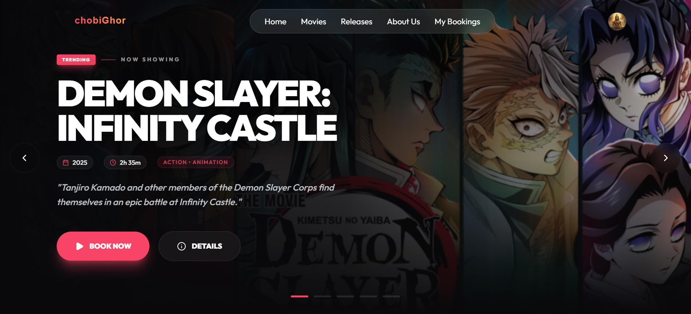      |          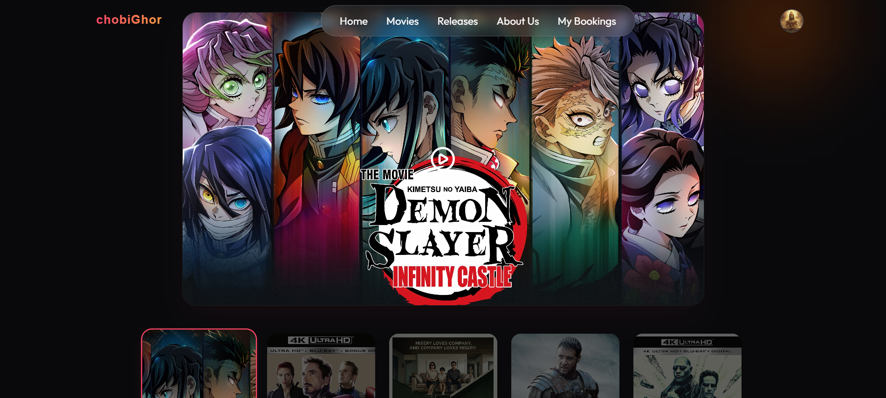          | 
| Admin Panel Dashboard | Ticket pdf |
| 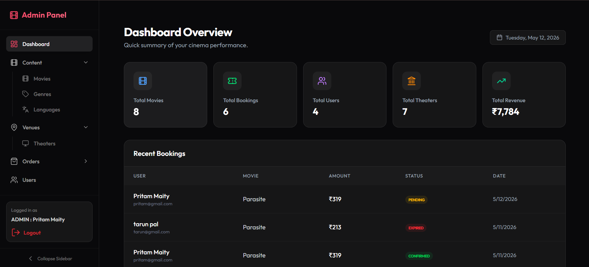 | 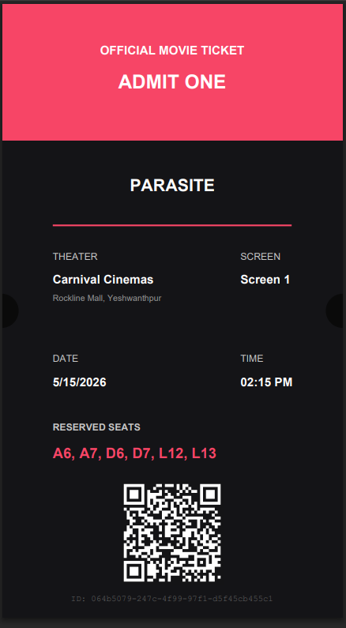 |
| All Movies View | Movie Details Page |
| :---: | :---: |
| 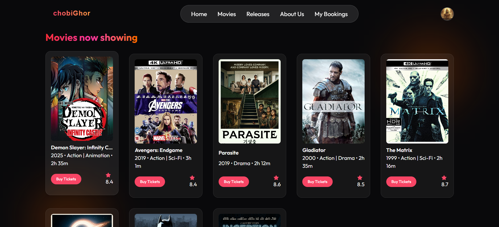 | 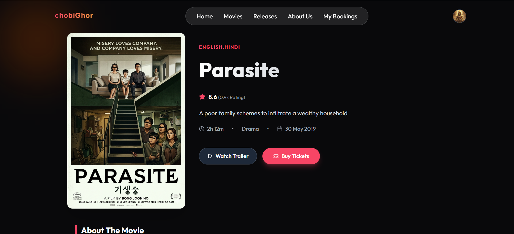 |

| Booking Flow | Seat Layout |
| :---: | :---: |
| 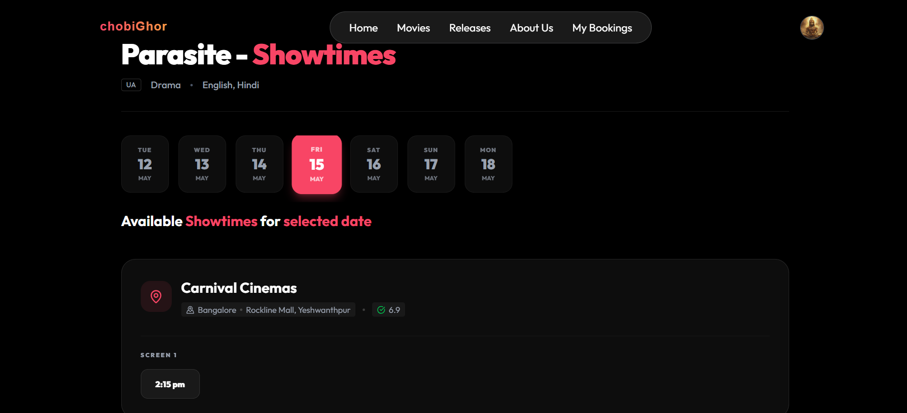 | 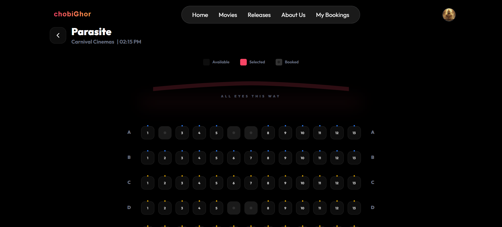 |

| Checkout Page | My Bookings |
| :---: | :---: |
| 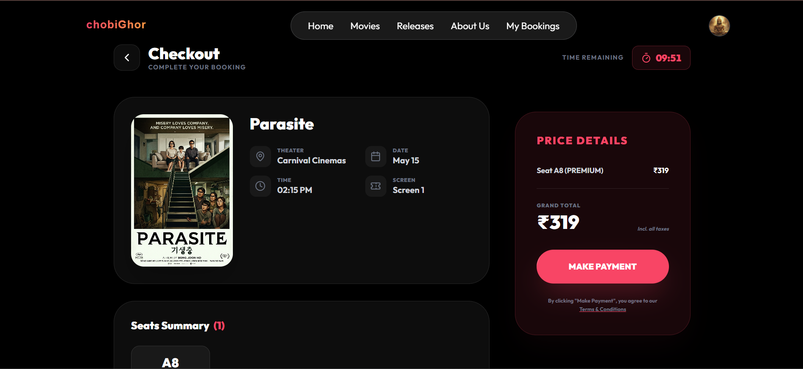 | 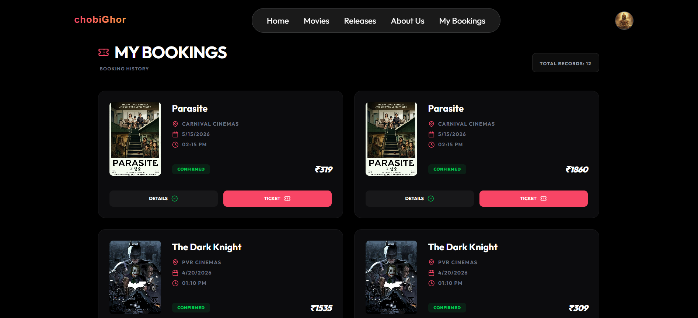 |

| Profile Management | |
| :---: | :---: |
| 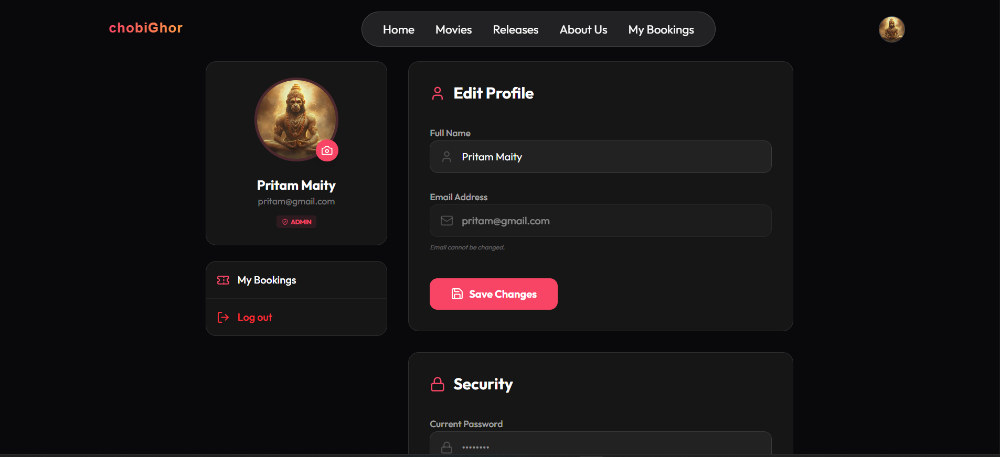 | |

### 🔐 Admin Panel
| All Bookings Management | Movie Management |
| :---: | :---: |
| 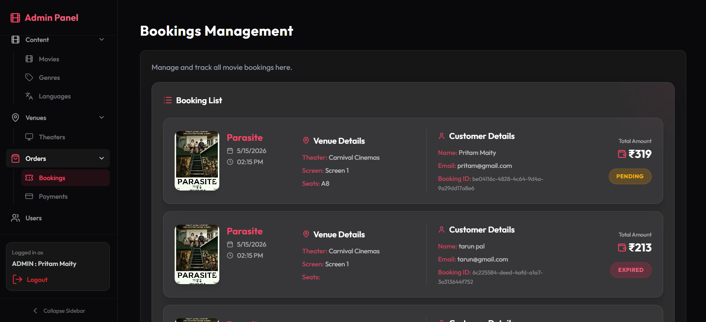 | 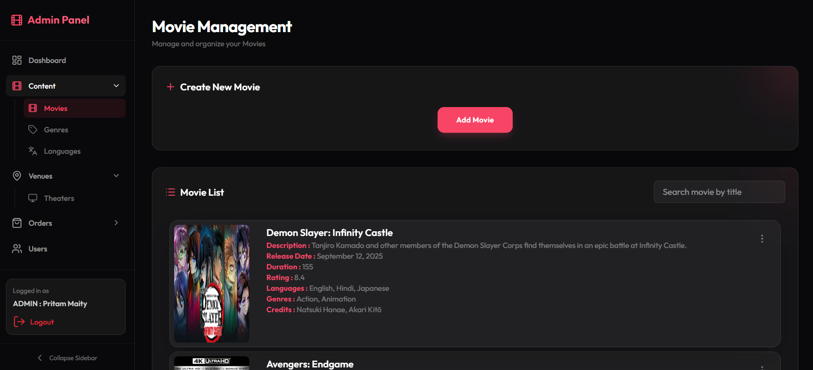 |

| Theater Management | |
| :---: | :---: |
| 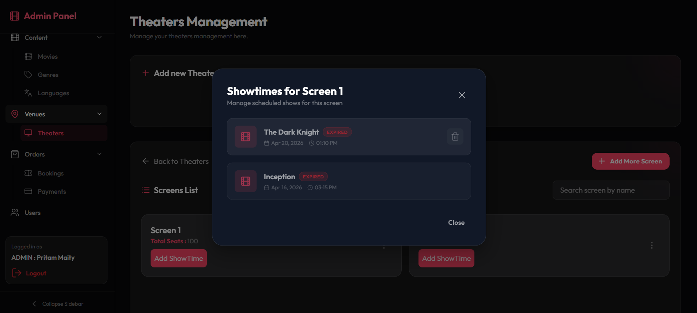 | |

---

## 📄 License

This project is licensed under the MIT License - see the [LICENSE](LICENSE) file for details.

---
⭐️ Thanks for visiting my project! Feel free to explore the code and try out the live demo above.
---
